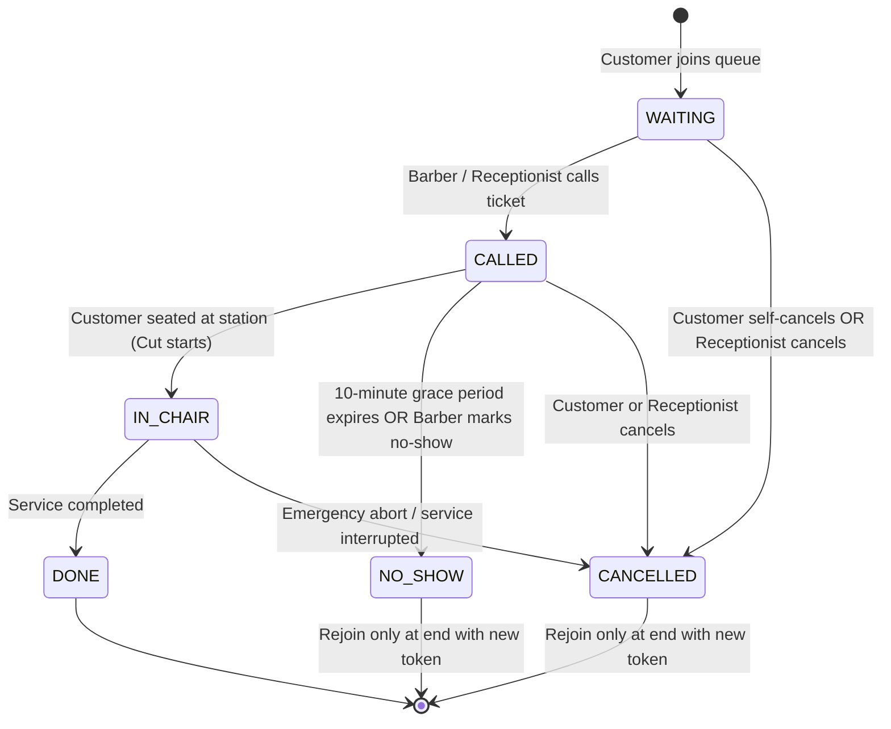

# CSS — Cascading Style Salon: Queue Flows & Business Rules

This document specifies the core algorithmic rules, state machines, validation logic, wait-time formulas, and test cases that govern queue operations in **CSS — Cascading Style Salon**.

---

## 1. Core Queueing Principles

### 1.1 First-Come, First-Served (FCFS) Baseline
The fundamental queue ordering is chronological by ticket creation timestamp (`createdAt`). Every customer who registers receives an immutable arrival timestamp. Within any eligible candidate pool (either a barber-specific queue or the shared pool), earlier timestamps always take precedence over later timestamps.

### 1.2 Barber Choice: Specific Barber vs. "Any Barber"
Customers are presented with two queueing modes upon registration:
1. **Specific Barber (`preferredBarberId = barberId`):**
   - The customer enters that barber's dedicated sub-queue.
   - The customer will *only* be called by and seated with that specific barber.
   - If that barber is busy, the customer waits even if other barbers become available.
2. **Any Barber (`preferredBarberId = "ANY"`):**
   - The customer enters the shared floor pool.
   - When *any* active barber frees up their chair and triggers `Call Next Customer`, the system resolves the candidate pool.

#### Resolution Algorithm When a Barber Becomes Available:
When Barber $B_k$ clicks `Call Next Customer`:
1. Find all tickets currently in state `WAITING`.
2. Filter for tickets where:
   - `preferredBarberId == B_k.id` **OR**
   - `preferredBarberId == "ANY"`
3. Sort this filtered candidate list by `createdAt` ascending (oldest arrival first).
4. Select the candidate at index `0` (the earliest arrival).
5. Transition that customer's ticket from `WAITING` &rarr; `CALLED`, binding them to Barber $B_k$ and their station.

### 1.3 One Active Customer Per Barber Rule
- At any given second, a barber station can have at most **one (1)** customer in state `IN_CHAIR`.
- A barber station can have at most **one (1)** customer in state `CALLED`.
- A barber cannot call a new customer while another customer is currently `IN_CHAIR` or `CALLED` at their station.
- To call the next customer, the current active ticket must transition into a terminal state (`DONE`, `CANCELLED`, or `NO_SHOW`).

---

## 2. Ticket Lifecycle State Machine

### State Definitions & Permissions

| State | Description | Who Can Trigger This Transition? | Station Status |
| :--- | :--- | :--- | :--- |
| `WAITING` | Ticket created; waiting in queue lounge or nearby. | Customer (via Kiosk/Mobile), Receptionist | None |
| `CALLED` | Barber is ready; 10-minute countdown active; alert displayed on TV and mobile screen. | Barber, Receptionist | Station Occupied (Calling) |
| `IN_CHAIR` | Customer is seated; haircut/styling in active progress. | Barber, Receptionist | Station Occupied (Active) |
| `DONE` | Service finished; customer leaves chair. Chair is freed. | Barber, Receptionist | Station Freed (Available) |
| `NO_SHOW` | Customer failed to appear after 10-minute grace period. Ticket closed. | Barber, Receptionist | Station Freed (Available) |
| `CANCELLED` | Spot given up prior to service completion. Ticket closed. | Customer (self-service), Receptionist | Station Freed (if was called) |

---

## 3. Cancellation, 10-Minute No-Show & Rejoining Rules

### 3.1 Customer Self-Cancellation
- While in state `WAITING` or `CALLED`, the customer has a prominent `Cancel My Spot` button on their personal status screen (`/status/:tokenId`).
- Tapping `Cancel My Spot` opens a modal confirmation explaining that cancellation is irreversible.
- Once confirmed:
  - Ticket transitions immediately to `CANCELLED`.
  - The ticket is permanently removed from active queue calculations.
  - If the customer was already in state `CALLED`, the calling barber's station is immediately freed to call the next customer.
  - Wait-time estimates for all subsequent customers are recalculated downwards.

### 3.2 10-Minute No-Show Policy & Grace Window
1. When a ticket enters `CALLED`, a strict **10-minute (600 seconds) grace timer** begins.
2. The waiting TV display highlights the token in pulsing cyan, and the customer's phone vibrates/chimes.
3. If 10 minutes elapse without the customer arriving and being seated:
   - An indicator badge turns Red: *"10-Minute Grace Period Expired"*.
   - The barber's interface flashes the `Mark No-Show` button.
   - The barber or receptionist marks `NO_SHOW`, immediately closing the ticket.
4. The station is immediately freed, and the barber can proceed to call the next waiting customer.

### 3.3 Strict Rejoining Policy: End of Line with New Token
- **No Line Reclaiming:** A customer who is marked `NO_SHOW` or who cancelled **cannot** be restored to their previous position.
- **New Token Generation:** If a no-show customer returns to the salon later and still wants a haircut:
  1. Their old token remains permanently archived as `NO_SHOW`.
  2. The customer must check in again (via kiosk, mobile, or front desk).
  3. The system generates a **brand-new token** (e.g., `CSS-028`).
  4. The customer is placed strictly at the **very end of the current queue** (FCFS order based on their new check-in timestamp).
  5. Front-desk staff may not manually bump or override a returning no-show ahead of other waiting customers.

---

## 4. Online Queue Closing 30 Minutes Before Salon Closing

To guarantee that all customers who enter the queue are served before the salon closes and that staff are not kept past operating hours:

1. **Automated Cutoff Rule:**
   - The online self-service queue (`/join`) and kiosk registration automatically close exactly **30 minutes prior to scheduled salon closing time**.
   - *Example:* If salon closing time is configured as `08:00 PM`, online check-in locks at `07:30 PM`.
2. **Cutoff Behavior:**
   - At the 30-minute threshold, the `Join Queue` buttons on `/` and `/join` disable immediately.
   - A banner displays across all public screens:
     *"Online & kiosk queue registration is closed for the day (closes 30 minutes before salon closing at 8:00 PM). All customers currently in line will be served."*
     (ગુજરાતી: *"આજ માટે કતાર નોંધણી બંધ છે (સલૂન બંધ થવાના ૩૦ મિનિટ પહેલાં બંધ થાય છે). હાલમાં લાઇનમાં રહેલા તમામ ગ્રાહકોની સેવા પૂર્ણ કરવામાં આવશે."*)
3. **Existing Tickets Handled:**
   - All tickets in `WAITING`, `CALLED`, or `IN_CHAIR` at the cutoff time continue through their normal lifecycle until the salon closes.

---

## 5. Barber Break Management Rules

Barbers take scheduled or spontaneous breaks (e.g., 15-minute tea break, 30-minute lunch). The system handles breaks cleanly without breaking queue integrity:

1. **Status Transition:**
   - When a barber triggers a break from `Barber View` or the front desk flags it, the barber's status changes from `ACTIVE` to `ON_BREAK`.
2. **Impact on "Any Barber" Shared Pool:**
   - The active barber count $N_{\text{active}}$ decrements by 1.
   - The shared candidate pool resolution algorithm completely bypasses barbers in `ON_BREAK` state.
   - No new customers are called to this station until the barber clicks `Resume Duty`.
3. **Impact on Specific Barber Waiting Lines:**
   - Any customers waiting specifically for this barber have the barber's break duration (e.g. 15 minutes) automatically added to their estimated wait time.
   - A notice appears on their tracker: *"Your stylist is currently on a quick 15-minute break and will resume shortly."*
4. **Resuming Duty:**
   - When the barber clicks `Resume Duty`, status returns to `ACTIVE`, $N_{\text{active}}$ increments, and the barber can immediately click `Call Next Customer`.

---

## 6. Duplicate Active Phone Number Prevention

To prevent spam, accidental double-submissions, and queue inflation:

1. **Normalization:**
   - All input phone numbers are stripped of formatting characters (spaces, hyphens, parentheses, country prefixes) to leave a standard 10-digit or E.164 string:
     $$\text{normalizedPhone} = \text{rawPhone.replace}(/[^\d]/g, '')$$
2. **Active Check:**
   - Before any ticket is added to the queue, the system queries the active ticket collection:
     $$\text{activeTickets} = \{ t \mid t.\text{status} \in \{\text{`WAITING`}, \text{`CALLED`}, \text{`IN\_CHAIR`}\} \}$$
   - If $\exists \, t \in \text{activeTickets}$ such that $t.\text{phone} == \text{normalizedPhone}$, the submission is **blocked**.
3. **User Feedback:**
   - The form does not create a duplicate. It returns a user-friendly error with a direct link to the existing ticket:
     *"You already have an active ticket (#CSS-009) in line! [Click here to view your ticket]"*.
4. **Post-Completion Reuse:**
   - Once a customer's previous ticket reaches a terminal state (`DONE`, `CANCELLED`, or `NO_SHOW`), that same phone number is immediately eligible to join the queue again (as a brand new ticket at the end of the line).

---

## 7. Token Generation Rules

Tokens provide a human-friendly, high-legibility identifier for TV displays, customer tickets, and staff communication.

### 7.1 Format: `CSS-###`
- Format: `CSS-` prefix followed by a zero-padded 3-digit daily sequence number:
  - `CSS-001`, `CSS-002`, ..., `CSS-099`, `CSS-100`, `CSS-101`, etc.
- In addition to the display token, every ticket is assigned an immutable internal `uuid` (e.g., `c8f1e280-9b34-4b92-801a-8e2b8346129a`) used for internal routing and secure URL access.

### 7.2 Daily Counter Reset
- The token counter starts at `1` each morning (`CSS-001`).
- The counter can be manually reset from the **Owner Settings** screen.
- Resetting the counter archives existing records and initializes the sequence index back to `1`.

---

## 8. Dynamic Wait Time Calculation Engine

Wait times are calculated dynamically based on real-time station occupancy, barber breaks, and service durations.

### 8.1 Baseline Parameters
- $D_s$: Duration of service requested by ticket $s$ in minutes (e.g., Haircut = 30 min, Beard = 15 min, Full Stack = 45 min).
- $B_{\text{active}}$: Set of barbers currently clocked in and active (excluding barbers on break).
- $N_{\text{active}} = |B_{\text{active}}|$: Count of active barbers.
- $T_{\text{cleaning}}$: Buffer time between cuts for station sanitization (configured at 5 minutes).
- $T_{\text{break}}$: Remaining minutes of a barber's active break (if applicable).

### 8.2 Formula for Specific Barber Queue
For a customer $C$ who requested a specific barber $B_k$:
$$\text{WaitTime}(C, B_k) = T_{\text{remaining}}(B_k) + T_{\text{break}}(B_k) + \sum_{i \in Q(B_k, < C)} \left( D_{s(i)} + T_{\text{cleaning}} \right)$$

Where:
- $T_{\text{remaining}}(B_k)$ is the estimated remaining time of the customer currently in chair with Barber $B_k$ (or 0 if chair is empty):
  $$T_{\text{remaining}}(B_k) = \max\left(2, D_{\text{current}} - \text{elapsedMinutes}\right)$$
- $T_{\text{break}}(B_k)$ is the remaining break duration if Barber $B_k$ is `ON_BREAK` (otherwise 0).
- $Q(B_k, < C)$ is the set of all customers in state `WAITING` or `CALLED` assigned to $B_k$ who arrived *before* customer $C$.

### 8.3 Formula for "Any Barber" Queue
For a customer $C$ who selected `Any Barber`:
1. Calculate the total remaining workload $W_{\text{total}}$ of all active barbers plus all waiting clients ahead of $C$:
   $$W_{\text{total}} = \sum_{b \in B_{\text{active}}} T_{\text{remaining}}(b) + \sum_{j \in Q_{\text{ahead}}(C)} \left( D_{s(j)} + T_{\text{cleaning}} \right)$$
2. Distribute the workload evenly across the active barber pool:
   $$\text{WaitTime}(C, \text{"ANY"}) = \max\left(5, \left\lceil \frac{W_{\text{total}}}{N_{\text{active}}} \right\rceil\right)$$

### 8.4 Minimum Display Floor
- If a customer is next in line to be called, the wait time displays: `~5 min (Next up)`.
- If their token is in state `CALLED`, the wait time displays: `0 min (Proceed to Chair)`.

---

## 9. Bilingual Localization Rules (English & Gujarati)

To ensure full accessibility for diverse clientele, all user interfaces, tokens, countdowns, and alerts support dual-language rendering:

1. **Locale Keys:** `en` (English) and `gu` (ગુજરાતી).
2. **Persistence:** Selected language is stored in `localStorage` under `css_salon_lang` and initialized to English (`en`) or owner default.
3. **Core Glossary:**
   | Term / Concept | English (`en`) | Gujarati (`gu`) |
   | :--- | :--- | :--- |
   | Home | Home | હોમ |
   | Join Queue | Join Queue | લાઇનમાં જોડાઓ |
   | Track My Spot | Track My Spot | મારી સ્થિતિ તપાસો |
   | Waiting | Waiting | પ્રતીક્ષામાં |
   | Called | You're Up! Please Proceed | તમારો વારો આવી ગયો છે! |
   | In Chair | In Chair | ખુરશી પર (સેવા ચાલુ) |
   | Done | Done | પૂર્ણ |
   | Cancelled | Cancelled | રદ કરેલ |
   | No-Show | No-Show | ગેરહાજર |
   | Any Barber | Any Available Barber (Fastest) | કોઈપણ ઉપલબ્ધ વાળંદ (સૌથી ઝડપી) |
   | Barber | Barber / Stylist | વાળંદ / સ્ટાઈલિશ |
   | Estimated Wait | Est. Wait Time | અંદાજિત સમય |
4. **Number Formatting:** In Gujarati mode, numerical tokens (`CSS-015`) maintain ASCII alphanumeric prefix for universal token matching, with optional localized digit rendering for wait-time counters.

---

## 10. Test Cases & Verification Matrix

The following test cases specify required inputs, initial conditions, actions, and expected system behavior.

### Test Case 1: Standard FCFS Single Barber Queue Progression
- **Initial State:** Barber Dave ($B_1$) is available at Station 1. Queue is empty.
- **Action:** Customer A (Token `CSS-001`, Haircut 30m) joins queue selecting Dave ($B_1$).
- **Expected Outcome:**
  - Token `CSS-001` created in `WAITING` state.
  - Est. wait time: `~5 min (Next up)`.
  - Dave's station shows `CSS-001` as next. Dave clicks `Call Next Customer`.
  - Token `CSS-001` shifts to `CALLED`. TV display sounds chime and highlights Station 1.
  - Customer A sits down. Dave clicks `Client Seated`.
  - Token shifts to `IN_CHAIR`. Timer starts.
  - Dave clicks `Finish Cut`. Token shifts to `DONE`. Station 1 becomes available.

### Test Case 2: "Any Barber" Routed to First Available Station
- **Initial State:** Barber Dave ($B_1$) is busy with Client 1 (20 min remaining). Barber Elena ($B_2$) finishes her cut and has an empty chair.
- **Action:** Customer B (Token `CSS-002`, "Any Barber") is waiting. Elena clicks `Call Next Customer`.
- **Expected Outcome:**
  - System resolves candidate pool: `CSS-002` is the oldest eligible waiting ticket.
  - `CSS-002` is bound to Barber Elena ($B_2$, Station 2).
  - Status shifts from `WAITING` to `CALLED` for Station 2.
  - TV screen announces: *"CSS-002 — Please proceed to Station 2 (Elena)"*.

### Test Case 3: Barber-Specific Queue Priority vs. "Any Barber" Arrival Times
- **Initial State:** Barber Dave ($B_1$) is busy.
  - Ticket 1: Customer X (`CSS-003`, Dave requested, arrived at 10:00 AM).
  - Ticket 2: Customer Y (`CSS-004`, Any Barber requested, arrived at 10:05 AM).
- **Action:** Barber Dave finishes his cut and clicks `Call Next Customer`.
- **Expected Outcome:**
  - Dave's candidates: `CSS-003` (Dave, 10:00 AM) and `CSS-004` (Any, 10:05 AM).
  - FCFS rule triggers: `CSS-003` arrived earlier (10:00 AM < 10:05 AM).
  - Dave calls `CSS-003`.
  - `CSS-004` remains in `WAITING` pool for the next available barber.

### Test Case 4: Rejection of Duplicate Active Phone Number
- **Initial State:** Customer with phone `(555) 234-5678` is currently in queue with Token `CSS-005` in state `WAITING`.
- **Action:** Customer attempts to submit the Join Queue form with phone `555-234-5678` or `5552345678`.
- **Expected Outcome:**
  - Phone normalizer recognizes matching string `5552345678`.
  - Submission is blocked. No new token is created.
  - UI displays error message: *"You already have an active ticket (CSS-005). View your live status here."* with link to `/status/CSS-005`.

### Test Case 5: Customer Self-Cancellation & Queue Recalculation
- **Initial State:**
  - Client 1 (`CSS-006`, Haircut 30m) is `IN_CHAIR` with Dave.
  - Client 2 (`CSS-007`, Haircut 30m) is `WAITING` for Dave (Est. wait: ~30 min).
  - Client 3 (`CSS-008`, Haircut 30m) is `WAITING` for Dave (Est. wait: ~60 min).
- **Action:** Client 2 opens their status screen and clicks `Cancel My Spot` &rarr; confirms modal.
- **Expected Outcome:**
  - `CSS-007` status transitions to `CANCELLED`.
  - `CSS-007` is removed from active line.
  - Client 3 (`CSS-008`) position advances to #1 in Dave's waiting line.
  - Client 3 estimated wait automatically drops from ~60 min to ~30 min.

### Test Case 6: 10-Minute No-Show Grace Period Expiration & Chair Release
- **Initial State:** Barber Elena calls Client Z (`CSS-009`). State is `CALLED`. 10-minute grace timer begins.
- **Action:** Exactly 10 minutes (600 seconds) elapse without Customer Z appearing at Station 2.
- **Expected Outcome:**
  - System flags ticket as expired (`Grace Period Expired`).
  - Elena's station activates the `Mark No-Show` button.
  - Elena clicks `Mark No-Show`.
  - `CSS-009` transitions to `NO_SHOW` and is archived.
  - Station 2 chair state is released to `Available`.
  - Elena's screen unlocks `Call Next Customer`.
  - TV screen removes `CSS-009` from "Now Calling" and Elena can call the next waiting customer.

### Test Case 7: Strict Rejoining Policy: Returning No-Show Rejoining at End of Line with New Token
- **Initial State:** Customer Z had ticket `CSS-009` which was marked `NO_SHOW` 15 minutes ago. Customer Z arrives at salon reception asking to get their haircut.
- **Action:** Receptionist attempts to check Customer Z back into the system.
- **Expected Outcome:**
  - Previous ticket `CSS-009` cannot be reinstated or un-cancelled.
  - Receptionist registers Customer Z as a fresh check-in.
  - System issues a brand-new token (e.g. `CSS-018`).
  - Customer Z is placed strictly at the **end of the queue** (behind all currently waiting clients).
  - Line integrity is preserved; no waiting customers are pushed back.

### Test Case 8: Barber Break Queue Redistribution & Wait Time Recalculation
- **Initial State:**
  - 2 Barbers active: Dave ($B_1$) and Elena ($B_2$).
  - Customer K (`CSS-010`, "Any Barber") is in state `WAITING`.
- **Action:** Elena toggles status to `Take 15-min Break`.
- **Expected Outcome:**
  - Active barber count $N_{\text{active}}$ drops from 2 to 1.
  - Station 2 shows `ON_BREAK` with 15-minute countdown.
  - Any Barber routing algorithm excludes Station 2.
  - Customer K's estimated wait time recalculates based on $N_{\text{active}} = 1$.
  - Elena cannot receive calls until she clicks `Resume Duty`.

### Test Case 9: Online Queue Auto-Close 30 Minutes Before Salon Closing
- **Initial State:** Salon operating hours: 09:00 AM to 08:00 PM. System clock reaches 07:30 PM.
- **Action:** A prospective customer opens `/` or `/join` on their phone to join the queue.
- **Expected Outcome:**
  - Online queue cutoff is triggered (current time $\ge$ Closing Time - 30 mins).
  - The `Join Queue` button is disabled.
  - A prominent notice displays in English and Gujarati: *"Online queue registration is closed for the day (closes 30 minutes before 8:00 PM closing). All currently waiting clients will be served."*
  - Already registered clients (`CSS-015`, `CSS-016`) remain in queue and continue to be served.

### Test Case 10: Strict Enforcement of One Active Customer Per Station
- **Initial State:** Barber Marco ($B_3$) currently has Customer M in chair (`IN_CHAIR`).
- **Action:** Barber Marco attempts to call next customer or seat another customer while Customer M is still in chair.
- **Expected Outcome:**
  - The `Call Next Customer` button is disabled / locked.
  - Attempting any programmatic call action triggers a validation error: *"Station 3 is currently occupied. Please complete the current haircut before calling next."*

### Test Case 11: Receptionist Manual Barber Reassignment
- **Initial State:** Customer R (`CSS-011`) is `WAITING` specifically for Barber Dave ($B_1$), who has 4 people waiting (~90 min wait). Barber Elena ($B_2$) has 0 people waiting.
- **Action:** Customer asks reception for a faster cut. Receptionist opens action menu for `CSS-011` and selects `Reassign Barber` &rarr; `Barber Elena`.
- **Expected Outcome:**
  - `CSS-011` preference updates: `preferredBarberId` changes from $B_1$ to $B_2$.
  - Dave's queue length decreases by 1; Dave's wait times recalculate downwards.
  - `CSS-011` immediately appears at the top of Elena's queue.
  - Elena's interface shows `CSS-011` as next up.

### Test Case 12: English & Gujarati Language Switching & State Persistence
- **Initial State:** User is on Customer Status screen `/status/CSS-015` in English mode. Status badge reads `WAITING`, wait time reads `~15 mins`.
- **Action:** User taps the `ગુજરાતી` button in the header language toggle.
- **Expected Outcome:**
  - UI immediately re-renders all labels without page reload:
    - Status badge updates to: `પ્રતીક્ષામાં`
    - Action button updates to: `મારી જગ્યા રદ કરો`
    - Instruction box updates to Gujarati text.
  - Local storage key `css_salon_lang` is set to `'gu'`.
  - Navigating to Home or Join Queue maintains Gujarati language mode.
